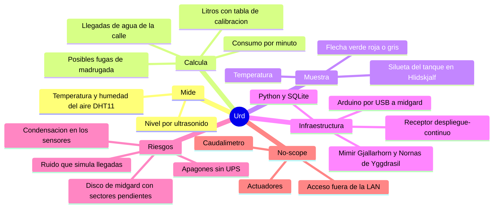

# Project Charter — Urd, monitor del tanque de agua

* **Estado:** approved
* **Fecha:** 2026-10-18
* **Decisores:** Jeremi
* **Fase AI-DLC:** 00-project
* **Versión:** 0.1.0
* **Sponsor:** Jeremi
* **Owner del proyecto:** Jeremi

## Visión
Saber en todo momento cuánta agua queda en el tanque de la casa, cuánta se está gastando y si
está llegando agua de la calle, de un vistazo en Hlidskjalf, el tablero de pared, y con aviso
cuando el tanque baja o algo no cuadra. El suministro de la calle es intermitente: saber cuándo
llega y cuánto dura es lo que permite administrar el agua.

Urðarbrunnr es el pozo bajo una de las raíces de Yggdrasil del que las Nornas sacan agua cada día
para regar el árbol. Urd sigue la convención de nombres de
[Yggdrasil](https://github.com/higerotech/yggdrasil) (`docs/00-project/naming.md`) y, como Bragi,
vive en su propio repositorio porque tiene hardware, datos y ciclo de vida propios.

## Alcance
- Incluye:
  - **Un tanque:** Q'Botella 3200 2K doble capa (Qtanque). 3150 L totales, 3100 L útiles,
    Ø 1,30 × 2,60 m, tapa de 54 cm y spud de 3/4"; el fabricante declara una tolerancia de
    hasta el 3 % en las medidas.
  - **Un Arduino Mega 2560 en el tanque**, con un HC-SR04 en la tapa y un DHT11 en la cabeza del
    tanque, conectado por USB a midgard (Ubuntu Server 24.04, i3-3240). El tanque está a ~9 m de
    midgard: más de los 5 m que admite un cable USB 2.0 pasivo, así que el enlace concreto se
    decide en un ADR del Gate 1.
  - **Servicio en Python** en un contenedor de midgard: convierte las lecturas en nivel, litros,
    consumo por minuto y estado de entrada de agua, y guarda lecturas y eventos en **SQLite**.
  - **Visualización en Hlidskjalf:** silueta del tanque con el nivel, número de temperatura y
    flecha de entrada (verde, roja o gris).
  - Alertas por la cadena de Yggdrasil (Mimir → Gjallarhorn → Nornas → push).
  - Despliegue continuo con el receptor de `higerotech/despliegue-continuo`, como Bragi.
- **No incluye (no-scope):**
  - **Actuadores:** ni bombas, ni válvulas, ni relés. Urd solo mide.
  - **Caudalímetro en la tubería de entrada.** La llegada de agua se deduce de la subida del
    nivel. Con el tanque lleno el flotador cierra y no se puede saber si hay agua en la calle
    (decisión del 2026-10-18: flecha de tres estados).
  - Temperatura del agua: el DHT11 mide el aire sobre el agua (decisión del 2026-10-18).
  - Acceso desde fuera de la LAN y aplicación móvil propia.
  - Más de un tanque.
  - Firmware actualizable por red (OTA): el Arduino se flashea a mano desde el PC.

## Mapa mental del alcance

## Stakeholders
| Rol | Persona | Interés |
|---|---|---|
| Sponsor / Owner / Admin | Jeremi | Datos fiables del agua sin mantenimiento constante |
| Usuarios | Familia | Ver en la tablet si queda agua y si está llegando |

## Criterios de éxito
1. Tras calibrar, el volumen que muestra Urd difiere del real en ≤ 3 % del volumen útil (≈ 93 L).
2. Una llegada de agua con entrada neta ≥ 3 L/min se muestra en verde en Hlidskjalf en ≤ 5 min.
3. El consumo diario que calcula Urd cuadra con el balance de nivel del día.
4. Urd sobrevive sin intervención a un apagón y a una desconexión del USB.
5. Un sensor que falla genera un aviso antes de que el tablero muestre datos falsos.

## Riesgos iniciales
| Riesgo | Impacto | Mitigación |
|---|---|---|
| Condensación sobre el transductor del HC-SR04, que no está sellado | Ecos falsos, nivel errático | Filtros de plausibilidad, alerta de sensor, contrato serie independiente del sensor para cambiarlo (JSN-SR04T) sin tocar el servicio |
| El DHT11 no tolera condensación (rango 20–90 % HR) y su precisión es ±2 °C | Lecturas que fallan o derivan; muere antes de tiempo | Alerta de sensor sin respuesta; el número se rotula «aire del tanque»; DS18B20 como reemplazo |
| La velocidad del sonido varía un 0,18 % por °C: entre 20 y 40 °C, una medida a 2 m se desvía ~7 cm (~94 L) | Nivel falso al sol | Compensación con la temperatura del DHT11 (RF07) |
| El hombro y el cuello del tanque: un cilindro de 1,30 × 2,60 m tendría 3451 L, no 3150 | Volumen falso en la parte alta | Tabla de calibración altura → volumen medida en sitio (RF01) |
| Ruido y oleaje (al llegar el agua, la superficie se mueve) | Falsas llegadas o falsos consumos | Mediana por minuto y pendiente sobre ventana; umbral y duración mínimos (RF03) |
| El disco de midgard tiene sectores pendientes; no hay UPS | Base SQLite corrupta o perdida | WAL, una escritura por minuto, respaldo nocturno al NAS (RNF03) |
| El USB se desconecta o el puerto cambia de nombre | Datos perdidos en silencio | Nombre fijo por udev, reconexión automática, alerta de datos viejos (RNF01) |
| Los datos de consumo revelan cuándo la casa está vacía | Privacidad de la familia | Los datos no salen de la LAN (RNF06) |
| Los ~9 m entre el tanque y midgard superan los 5 m de un cable USB 2.0 pasivo, y ese cable une el exterior con el router de la casa | Enlace inestable; una sobretensión en el tramo del tanque llega a midgard | Enlace que cubra 9 m con aislamiento galvánico (RNF08), decidido en un ADR del Gate 1 |
