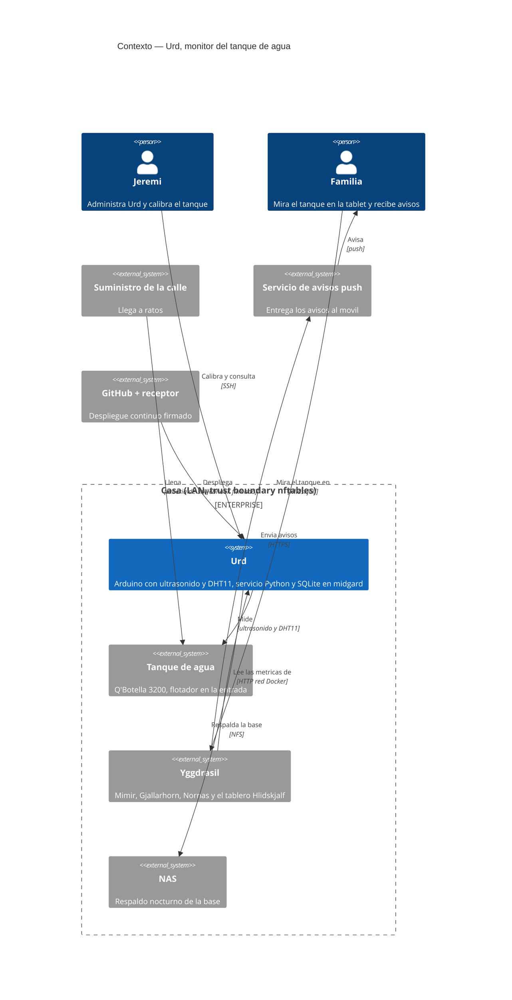
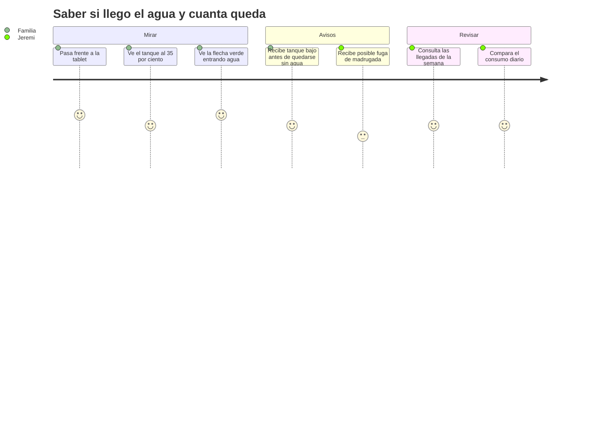
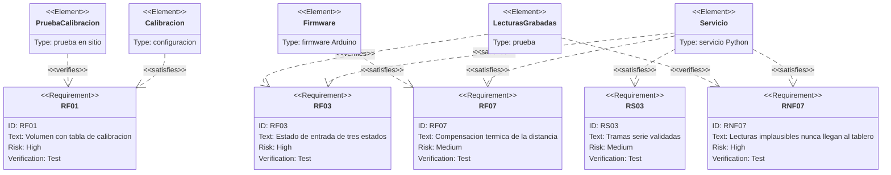
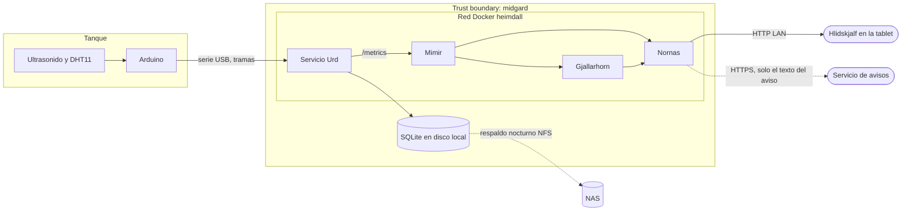
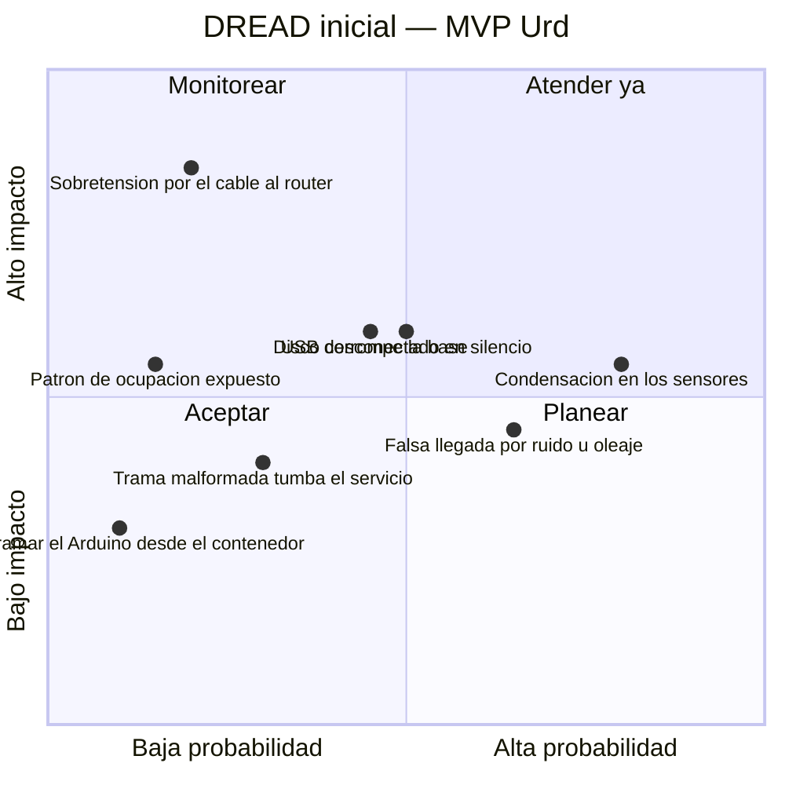

# PRD — Monitor del tanque de agua (Urd)

* **Estado:** approved
* **Fecha:** 2026-10-18
* **Decisores:** Jeremi
* **Fase AI-DLC:** 01-requirements
* **Versión:** 0.1.0
* **Gate:** 0
* **Feature ID:** URD-001
* **ASVS:** L1 (V5 validación de entradas, V7 registro y errores, V8 protección de datos, V14 configuración)

## Problema
El agua de la calle llega a ratos y no se sabe cuándo. Hoy, para saber cuánta queda en el tanque
o si está entrando, hay que subir a mirarlo. Tampoco se sabe cuánto se gasta al día ni si hay una
fuga. midgard ya tiene un tablero de pared (Hlidskjalf) y una cadena de avisos (Yggdrasil): falta
medir el tanque.

## Objetivos
1. Ver en Hlidskjalf, de un vistazo, el nivel del tanque, la temperatura y si está llegando agua.
2. Conocer el consumo por minuto y por día, y las llegadas de agua con su duración y sus litros.
3. Recibir un aviso cuando el tanque baja, cuando parece haber una fuga y cuando un sensor falla.
4. Que los datos sean fiables o digan que no lo son: nunca un tablero en verde con datos falsos.

## No-objetivos
Ver el no-scope del [charter](../00-project/charter.md): actuadores, caudalímetro, temperatura del
agua, acceso fuera de la LAN, más de un tanque y firmware por red.

## Lo que la física permite medir
Las cifras salen del tanque (Ø 1,30 × 2,60 m) y fijan qué se puede prometer:

- **El cuerpo cilíndrico guarda 13,3 L por cm.** Un centímetro de error son 13 L.
- **La parte alta no es cilíndrica.** Un cilindro de esas medidas tendría 3451 L y el tanque
  declara 3150 L: unos 300 L se pierden en el hombro y el cuello. La relación altura → volumen
  solo se conoce calibrando en sitio.
- **Un consumo pequeño y aislado no se ve.** Una ducha (~9 L/min) baja el nivel ~0,7 cm/min y se
  mide bien. Lavarse las manos (~2 L) son 1,5 mm, por debajo del ruido del sensor (del orden de
  ±3 mm, a medir en el Gate 3). El consumo diario sí cuadra, porque es la diferencia de nivel.
- **El nivel solo ve el balance neto.** Si entra agua mientras se gasta, se mide la diferencia:
  durante una llegada no se puede separar el consumo.
- **Con el tanque lleno, el flotador cierra** y no se sabe si la calle tiene agua: por eso hay un
  tercer estado, gris.
- **La velocidad del sonido cambia un 0,18 % por °C.** Entre 20 y 40 °C, una distancia de 2 m se
  desvía ~7 cm (~94 L). Sin compensación térmica, el sol mueve el nivel.
- **El HC-SR04 mide de 2 cm a 4 m.** Con el tanque casi vacío, la distancia ronda los 2,6 m:
  dentro del rango, pero con un eco más débil. Además, un haz de ~15° a 2,5 m abre un círculo de
  ~0,67 m de radio, parecido al del tanque: con poco nivel puede rebotar en la pared.
- **El tanque está a ~9 m de midgard.** Un cable USB 2.0 pasivo admite 5 m. Los 9 m piden un
  enlace activo o de otro tipo, y ese cable une el exterior con el router de la casa (RNF08).

## Requisitos funcionales
| ID | Requisito | Verificación |
|---|---|---|
| RF01 | Urd publica cada minuto la altura de agua, el volumen en litros y el nivel (% del útil), con una tabla de calibración altura → volumen | Prueba de calibración en sitio: tres niveles conocidos; error ≤ 3 % del volumen útil |
| RF02 | Urd publica cada minuto el consumo (L/min) como pendiente del volumen sobre una ventana móvil (5 min por defecto) y acumula el consumo diario | Prueba: vaciar un volumen conocido a caudal constante y comparar |
| RF03 | Urd mantiene el estado de entrada: **entrando** si la subida neta supera un umbral durante un tiempo mínimo (3 L/min durante 3 min por defecto), **lleno** si el nivel está en la zona de cierre del flotador, **sin entrada** en otro caso, y **sin datos** si las muestras están viejas | Prueba con llegadas reales y con lecturas grabadas reproducidas |
| RF04 | Cada llegada de agua queda registrada con su inicio, su fin, su duración y los litros recibidos | Prueba con lecturas grabadas |
| RF05 | Urd publica la temperatura y la humedad del aire del tanque (DHT11) cada minuto | Inspección del `/metrics` y de SQLite |
| RF06 | Hlidskjalf muestra una silueta del tanque con el nivel y los litros, la temperatura rotulada «aire del tanque» y la flecha de entrada: verde (entrando), roja (sin entrada), gris (lleno) | Prueba en la tablet (WebView 81) |
| RF07 | La distancia se corrige con la velocidad del sonido a la temperatura del aire del tanque | Prueba unitaria y comparación con una medida a mano a dos temperaturas |
| RF08 | Avisos por la cadena de Yggdrasil: tanque bajo (< 20 % por defecto), posible fuga (consumo ≥ 0,5 L/min sostenido 60 min entre las 02:00 y las 05:00 de la casa), sensor fallando y sin datos | Prueba de extremo a extremo con aviso push recibido (HITL) |
| RF09 | SQLite guarda las muestras por minuto, las llegadas y los consumos diarios, y se puede consultar desde midgard | Inspección |

## Requisitos no funcionales
| ID | Requisito |
|---|---|
| RNF01 | El servicio tolera que el Arduino se desconecte y vuelva (nombre fijo por udev, reconexión automática) sin reinicio manual, y avisa si no llegan datos en 5 min |
| RNF02 | Todo arranca solo tras un apagón (midgard no tiene UPS) |
| RNF03 | Como máximo una escritura en SQLite por minuto, en modo WAL, y la base entra en el respaldo nocturno al NAS: el disco de midgard tiene sectores pendientes |
| RNF04 | El servicio no pasa de 0,25 CPU ni de 128 MiB: midgard es el router de la casa |
| RNF05 | Una llegada con entrada neta ≥ 3 L/min se refleja en Hlidskjalf en ≤ 5 min |
| RNF06 | Las muestras y las llegadas no salen de la LAN; solo sale el texto de los avisos |
| RNF07 | Una lectura implausible (fuera de rango, salto imposible entre minutos, sensor sin respuesta) nunca llega al tablero como dato bueno: se descarta, se cuenta y, si persiste, dispara el aviso de sensor |
| RNF08 | El enlace entre el Arduino y midgard cubre ~9 m sin errores sostenidos, y una falla eléctrica en el tramo del tanque (sobretensión, fuga a tierra) no puede llegar a midgard: hace falta aislamiento galvánico |

## Requisitos de seguridad (ASVS L1)
| ID | Requisito | ASVS | OWASP Top 10:2025 |
|---|---|---|---|
| RS01 | Sin puertos publicados: `/metrics` solo en la red Docker de Heimdall, como `bragi-metricas` | V14.4 | A02 |
| RS02 | Contenedor sin root, con `cap_drop: ALL`, `no-new-privileges`, sistema de ficheros de solo lectura salvo el directorio de datos, y acceso solo al dispositivo `/dev/urd` (nunca `privileged`) | V14.2 | A02 |
| RS03 | Cada trama serie se valida antes de usarla: longitud máxima, formato, versión de firmware y rangos físicos. Una trama inválida se descarta y se cuenta; nunca tumba el servicio | V5.1 | A05, A10 |
| RS04 | Imágenes pineadas por digest; sin `latest` | V14.2 | A03, A08 |
| RS05 | Ningún dato de la instalación en el repo (calibración, serie del Arduino, IPs) | V14.1 | A02 |
| RS06 | Las consultas a SQLite usan parámetros, nunca texto concatenado | V5.3 | A05 |
| RS07 | Los fallos de sensor, las tramas descartadas y las reconexiones se registran y se cuentan en `/metrics`: un fallo no queda en silencio | V7.1 | A09 |

## Escenarios de abuso y de fallo
| ID | Escenario | Control |
|---|---|---|
| AB01 | La condensación sobre el transductor produce ecos falsos y el tablero muestra un nivel imposible | RNF07, aviso de sensor (RF08) |
| AB02 | El oleaje al llegar el agua, o el eco en la pared con poco nivel, simula una llegada o un consumo | Mediana por minuto, umbral y duración mínimos (RF03), pruebas con lecturas grabadas |
| AB03 | Una trama malformada o gigante (firmware con un error, ruido eléctrico en el USB) tumba el servicio o mete valores absurdos | RS03 |
| AB04 | Un contenedor comprometido usa su acceso al puerto serie para reprogramar el Arduino (el bootloader acepta firmware por USB) | RS02; el Arduino no tiene actuadores, así que el daño se limita a lecturas falsas. Riesgo aceptado en Gate 1 si no hay control mejor |
| AB05 | El patrón de consumo revela cuándo la casa está vacía | RNF06, sin acceso fuera de la LAN |
| AB06 | El disco de midgard corrompe la base o un apagón corta una escritura | RNF03 (WAL, respaldo nocturno, `integrity_check` en el respaldo) |
| AB07 | El USB se desconecta y el tablero sigue enseñando el último nivel como si fuera actual | RNF01, estado **sin datos** (RF03) |
| AB08 | Una llegada mientras se consume a la vez no se ve, y la flecha queda en rojo | Límite físico del balance neto: documentado, no se mitiga sin caudalímetro (no-scope) |
| AB09 | Una sobretensión o una fuga a tierra en el tramo de 9 m entre el tanque y midgard daña el router de la casa | RNF08 (aislamiento galvánico); el enlace se elige en un ADR del Gate 1 |

## Contexto

*Eje estructura · fase 01 · Gate 0.*

## Recorrido del usuario

*Eje trazabilidad · fase 01 · Gate 0.*

## Trazabilidad

*Eje trazabilidad · fase 01 · Gate 0.*

## Threat assessment inicial

*Eje comportamiento · DFD inicial · Gate 0. Tres fronteras: el cable USB (la entrada que hay que
validar), la LAN hacia la tablet y la salida a internet de los avisos.*

*Eje trazabilidad · DREAD · Gate 0. El análisis completo, con STRIDE, irá en el Gate 1.*

## Decisiones tomadas (HITL, 2026-10-18)
| Decisión | Alternativa recomendada que se descartó | Riesgo aceptado |
|---|---|---|
| Urd solo mide en esta etapa | — | Sin actuadores: no corta la bomba ni abre válvulas |
| Arduino Mega 2560 por USB a midgard; el tanque está a ~9 m | ESP32 por WiFi a Ratatosk; Uno o Nano | 9 m superan los 5 m del USB 2.0 pasivo: el enlace (cable activo con aislador, RS-485 u otro) se decide en un ADR del Gate 1. Un Mega clónico con CH340 no trae número de serie, y la regla udev tendría que ir por puerto |
| DHT11 en la cabeza del tanque | DS18B20 sumergible para el agua | Mide el aire, no el agua; ±2 °C; puede fallar por condensación |
| HC-SR04 (trigger y echo) | JSN-SR04T impermeable; sensor de presión | Ecos falsos por condensación a la larga |
| Flecha de tres estados, sin caudalímetro | Caudalímetro YF-B6 en la entrada | Con el tanque lleno no se sabe si hay agua en la calle |
| Umbrales iniciales propuestos: error ≤ 3 %; llegada ≥ 3 L/min durante 3 min, visible en ≤ 5 min; tanque bajo < 20 %; fuga ≥ 0,5 L/min durante 60 min entre las 02:00 y las 05:00; muestras por minuto 400 días | — | Son de partida: se revisan con datos reales en el Gate 5 |
