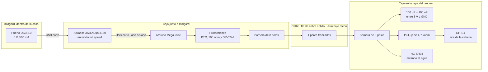
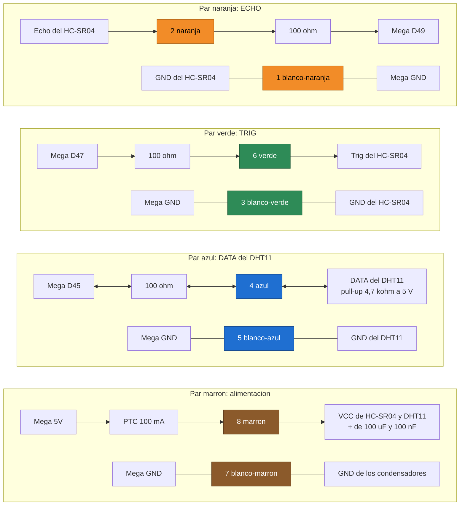
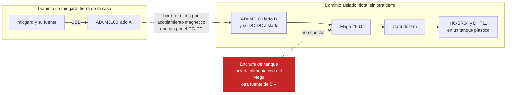

# Conexión de los sensores por Cat6

* **Estado:** draft
* **Fecha:** 2026-10-18
* **Decisores:** Jeremi
* **Fase AI-DLC:** 02-design
* **Versión:** 0.1.0
* **Gate:** 1
* **Requisitos:** RNF08, AB09 ([PRD](../01-requirements/monitor-tanque.md))

## Resumen
El Arduino Mega 2560 queda **junto a midgard**, dentro de la casa. Lo alimenta y lo comunica un
USB corto, que pasa por un aislador ADuM3160. Hasta el tanque solo van los sensores, por un
**Cat6 UTP de ~9 m** que corre bajo techo por el perímetro exterior de la casa. Así el USB nunca
pasa de sus 5 m, el Mega se reprograma a mano sin subir al tanque y no hace falta el enchufe del
tanque.

La elección del enlace frente a RS-485 se registra en un ADR del Gate 1. Este documento es el
detalle de la conexión.

## Vista general

*Eje estructura · fase 02 · Gate 1. Las dos cajas usan borneras, no conectores RJ45 (ver
«Errores que hay que evitar»).*

## Pines del Mega
Los tres pines están en la misma columna del conector doble, entre los 5 V de un extremo y los GND
del otro: un solo mazo de cables.

| Pin | Uso | Por qué ese pin |
|---|---|---|
| 5V | Alimentación de los sensores, a través del PTC | Sale del USB del Mega (polyfuse de 500 mA) |
| GND | Retorno común | Extremo del conector doble |
| D47 | TRIG del HC-SR04 (salida, pulso de 10 µs) | Libre y junto a los otros dos |
| D49 | ECHO del HC-SR04 (entrada) | Es ICP4: si `pulseIn` no basta, el Timer4 puede medir el eco por hardware con 0,5 µs de resolución |
| D45 | DATA del DHT11 (entrada y salida) | Libre y junto a los otros dos |

## Mapa del cable (T568B)
Cada señal va en su propio par trenzado con una tierra. El ruido que se induce en un par afecta a
la señal y a su retorno por igual, y se cancela. El marrón lleva la alimentación con su propio
retorno, para que el lazo de corriente también quede trenzado.

| Par | Conductor | Señal | Extremo del Mega | Extremo del tanque |
|---|---|---|---|---|
| Naranja | 2 naranja | ECHO | 100 Ω → D49 | Echo del HC-SR04 |
| Naranja | 1 blanco-naranja | GND | GND | GND del HC-SR04 |
| Verde | 6 verde | TRIG | D47 → 100 Ω | Trig del HC-SR04 |
| Verde | 3 blanco-verde | GND | GND | GND del HC-SR04 |
| Azul | 4 azul | DATA | D45 ↔ 100 Ω | DATA del DHT11 y pull-up a 5 V |
| Azul | 5 blanco-azul | GND | GND | GND del DHT11 |
| Marrón | 8 marrón | +5 V | 5V → PTC 100 mA | VCC de los dos sensores y + de los condensadores |
| Marrón | 7 blanco-marrón | GND | GND | GND de los condensadores |

## Conexiones par por par

*Eje estructura · fase 02 · Gate 1. Las flechas siguen el sentido de la señal: el ECHO va del
tanque al Mega y el DATA del DHT11 va en los dos sentidos.*

## Protecciones en la caja de midgard
El cable corre 9 m por el exterior. Las protecciones van en el extremo del Mega para que lo que
se induzca en el cable no llegue a sus pines.

- **SRV05-4.** Un arreglo de diodos TVS fija las tres señales y el riel de 5 V a GND ante una
  descarga o un pico inducido.
- **100 Ω en serie** en TRIG, ECHO y DATA. Limitan la corriente que entra a los diodos de
  protección y amortiguan los rebotes del flanco en el cable.
- **PTC de 100 mA** en los 5 V que salen al cable. Si el cable se aplasta y hace corto, el PTC
  corta y el Mega sigue vivo para avisar de que los sensores no responden (RS07), en lugar de
  reiniciarse en bucle.

## Caja del tanque
- **100 µF electrolítico + 100 nF cerámico** entre +5 V y GND, junto al HC-SR04. El emisor tira
  picos de corriente en cada disparo, y 9 m de cable no los entregan a tiempo.
- **Pull-up de 4,7 kΩ** de DATA a +5 V, junto al DHT11. La hoja de datos lo pide hasta 20 m de
  cable, con el DHT11 alimentado a 5 V. Si el DHT11 viene en un módulo con su propia resistencia
  (suele ser de 10 kΩ), las dos quedan en paralelo (~3,2 kΩ), y sigue sirviendo.
- **El HC-SR04 en la tapa**, apuntando recto al agua. El DHT11 va en la cabeza del tanque, fuera
  del chorro de la entrada.

## Tierras y aislamiento (RNF08)

*Eje estructura · fase 02 · Gate 1. Todo lo que está a la derecha de la barrera comparte una sola
tierra, la del lado aislado. Ni el tanque ni la caja tocan otra.*

El ADuM3160 corta el camino eléctrico entre el cable exterior y el router. Un pico en el tramo de
9 m se queda del lado aislado: en el peor caso se pierde el Mega o el aislador, pero no midgard.
El aislamiento solo vale si **nada más** toca el lado aislado. Por eso el Mega no lleva otra
fuente, y la caja del tanque no se conecta a ninguna tierra.

## Presupuesto de energía
Consumos de la hoja de datos o estimados. Se miden en el Gate 3 con un amperímetro USB.

| Carga | Consumo |
|---|---|
| Arduino Mega 2560 (ATmega2560 y su chip USB) | ~70 mA (estimado) |
| HC-SR04 | 15 mA en funcionamiento |
| DHT11 | ≤ 2,5 mA midiendo |
| **Total** | **~90 mA** |
| Lado aislado del ADuM3160 (DC-DC de 1 W) | ~200 mA disponibles: comprobar el módulo concreto |
| Puerto USB 2.0 de midgard | 500 mA |

En la línea de 5 V caen ~30 mV a lo largo del cable (Cat6: ≤ 9,4 Ω por 100 m y conductor).

## Por qué el Cat6 basta
- **ECHO.** El HC-SR04 mide con la duración del pulso: cada centímetro son 58 µs. El cable añade
  unos 450 pF (~50 pF/m). Con la resistencia de 100 Ω en serie y la salida del sensor, eso redondea los flancos en ~0,1 µs, y los dos
  flancos se retrasan por igual. El error que queda está muy por debajo de 0,1 mm.
- **TRIG.** Es un pulso de 10 µs que solo tiene que superar el umbral del HC-SR04, y lo hace con
  holgura.
- **DATA del DHT11.** El bit más corto dura 26 µs. Con 4,7 kΩ y 450 pF, la subida tarda ~5 µs. Si
  la prueba da errores de suma de control, se baja el pull-up a 2,2 kΩ.
- **Lo que sí puede fallar** es el ruido que se induzca en el cable, no su longitud: por eso cada
  señal va en su propio par con su retorno, y por eso se hace la prueba en banco.

## Errores que hay que evitar
- **Conectores RJ45.** Si alguien enchufa este cable a un switch, a un inyector PoE pasivo o a un
  puerto de midgard, le mete 24–48 V o tensión de red Ethernet al Mega. Lo mejor es usar borneras
  en los dos extremos. Si se usan rosetas RJ45, hay que rotularlas «SENSORES — NO ES RED».
- **Cable CCA** (aluminio recubierto de cobre). Tiene más resistencia y se quiebra en la bornera:
  el cable tiene que ser de cobre sólido.
- **Cubierta para interior al sol.** El cable va bajo techo, pero por fuera: en canaleta o con
  cubierta para exterior.
- **Alimentar el Mega por el jack** o desde el enchufe del tanque. Rompe el dominio aislado.
- **El ADuM3160 en modo low speed.** El chip USB del Mega va a full speed (12 Mbit/s): el puente
  o interruptor de velocidad del módulo tiene que estar en *full*.

## Lista de materiales

| Cantidad | Pieza |
|---|---|
| 1 | Arduino Mega 2560 |
| 1 | HC-SR04 |
| 1 | DHT11 (suelto o en módulo) |
| 1 | Módulo aislador USB ADuM3160 con DC-DC aislado (full speed) |
| 2 | Cable USB corto: A a B para el Mega, y el que pida el módulo aislador |
| ~11 m | Cat6 UTP de cobre sólido, cubierta para exterior o en canaleta (9 m más holgura) |
| 2 | Bornera de 8 polos |
| 1 | SRV05-4 (arreglo TVS de 4 líneas) |
| 3 | Resistencia de 100 Ω |
| 1 | Resistencia de 4,7 kΩ (y una de 2,2 kΩ de repuesto) |
| 1 | PTC rearmable de 100 mA de mantenimiento |
| 1 | Electrolítico de 100 µF, 16 V |
| 1 | Cerámico de 100 nF |
| 2 | Cajas de conexión; la del tanque, con buena ventilación por la condensación |

## Prueba en banco antes de instalar (Gate 3)
Con el mismo rollo de Cat6, enrollado y de ~10 m, frente a un cable corto de 20 cm:

1. **HC-SR04:** 1000 lecturas a una distancia fija con cada cable. La mediana debe diferir en
   ≤ 1 mm, la dispersión en ≤ ±3 mm, y los ecos perdidos deben ser ≤ 1 %.
2. **DHT11:** 500 lecturas con cada cable. Errores de suma de control ≤ 1 %, y si no, se baja el
   pull-up a 2,2 kΩ.
3. **Consumo:** medir la corriente en el puerto de midgard con los dos sensores trabajando, y
   comprobar que queda bajo lo que da el lado aislado del ADuM3160.
4. **Corto en el cable:** unir +5 V y GND en el extremo del tanque. El PTC debe cortar, el Mega
   debe seguir enumerado en midgard y el servicio debe contar el fallo de sensor.

Si el ECHO no cumple el punto 1, el plan B usa el mismo Cat6 para RS-485: el Mega se va a la caja
del tanque, alimentado del enchufe de allá, y en midgard entra un adaptador USB a RS-485 aislado.

## Pendiente
- Saber si el Mega es original (chip USB ATmega16U2, con número de serie) o un clon con CH340 (sin
  número de serie: la regla udev iría por el puerto físico).
- Medir el recorrido real del cable para ajustar la holgura.
