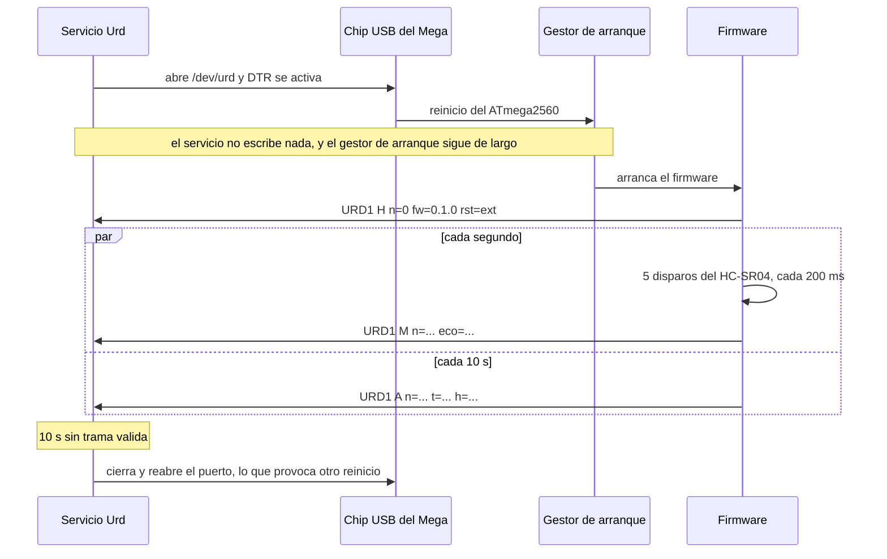
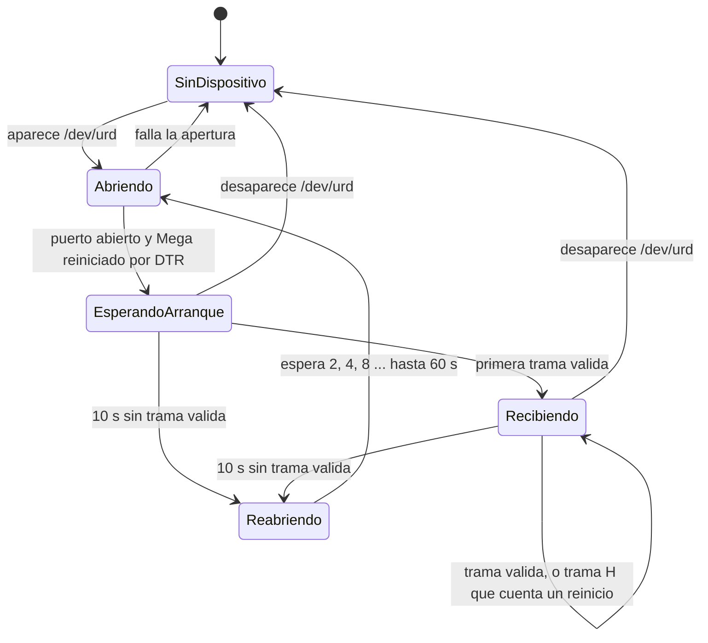

# Contrato de la trama serie (URD1)

* **Estado:** draft
* **Fecha:** 2026-10-18
* **Decisores:** Jeremi
* **Fase AI-DLC:** 02-design
* **Versión:** 0.1.0
* **Gate:** 1
* **Requisitos:** RF01, RF05, RF07, RNF01, RNF07, RS03, RS07, AB03, AB04, AB07
* **Relacionado:** [ADR-0001](../00-project/adr/ADR-0001-enlace-al-tanque-por-cat6.md),
  [conexión de los sensores](conexion-sensores.md)

## Resumen
El Mega habla, el servicio escucha. Cada trama es **una línea de texto ASCII** que empieza por la
versión del protocolo y termina con una suma de verificación. El firmware manda **datos crudos**:
el tiempo de eco en µs y la lectura del DHT11, sin convertir. La física (compensación térmica,
calibración, medianas, litros) vive en el servicio, donde se prueba y se cambia sin flashear la
placa.

## Principios
1. **Unidireccional.** El servicio **nunca escribe** en el puerto, y el firmware descarta todo lo
   que le llegue. Así no hay comandos que validar en la placa, y una escritura en el momento del
   arranque no puede dejar al gestor de arranque en modo programación. Los comandos AT que mande
   cualquier otro programa, como ModemManager, se pierden sin efecto.
2. **Datos crudos.** El firmware entrega el tiempo de eco, no la distancia. RF07 (corrección por
   la velocidad del sonido) la aplica el servicio. Esto afina la trazabilidad del PRD, que se la
   asignaba también al firmware.
3. **Texto legible.** `cat /dev/urd` basta para depurar. Son ~50 bytes por segundo: el formato
   binario no ahorraría nada que importe.
4. **Toda trama dice su versión.** El servicio rechaza una versión que no conoce, en lugar de
   interpretarla mal.
5. **Ni un `!`.** El gestor de arranque de esta placa (Mega 2560 de primera generación,
   `2341:0010`) se cuelga al cargar un firmware que contenga `!!!`. El protocolo no usa ese
   carácter.

## Parámetros del enlace
| Parámetro | Valor |
|---|---|
| Puerto | `/dev/urd` (regla udev de ADR-0001) |
| Velocidad | 115200 baudios, 8N1, sin control de flujo |
| Fin de línea | `LF` (0x0A). El servicio tolera un `CR` previo |
| Juego de caracteres | ASCII imprimible (0x20–0x7E) |
| Longitud máxima | 96 bytes con el fin de línea |
| Hora | La pone el servicio al recibir: el Mega no tiene reloj |

## Formato

```
trama    = cuerpo " *" suma LF
cuerpo   = "URD" version " " tipo " " campo *( " " campo )
version  = 1*DIGITO                ; "1" en este contrato
tipo     = "A"-"Z"                 ; H, M o A en este contrato
campo    = clave "=" valor
clave    = 1*( "a"-"z" )
valor    = 1*( DIGITO / "a"-"z" / "." / "," / "_" / "-" / "?" )
suma     = 2HEXMAYUS               ; XOR de todos los bytes de cuerpo
```

La suma es el XOR de todos los bytes del cuerpo, en dos dígitos hexadecimales en mayúsculas, al
estilo NMEA. El USB ya protege cada paquete con CRC16 y lo reenvía si falla, así que la suma no
está para errores de transmisión. Está para detectar **líneas cortadas o pegadas**, la basura del
arranque y los errores del firmware.

Todas las tramas llevan `n`, un contador de 32 bits que empieza en 0 con la trama `H` y sube de 1
en 1 con cada trama. Si salta, se han perdido tramas.

## Tipos de trama

### H: arranque
Una vez, al arrancar el firmware.

| Campo | Contenido | Rango |
|---|---|---|
| `n` | Siempre `0` | `0` |
| `fw` | Versión del firmware | `X.Y.Z` |
| `rst` | Causa del reinicio, si el gestor de arranque la conserva | `po` encendido, `ext` botón o DTR, `bo` caída de tensión, `wdt` watchdog, `?` desconocida |

`URD1 H n=0 fw=0.1.0 rst=ext *65`

### M: medida de nivel
Cada segundo, con **cinco disparos** del HC-SR04 separados 200 ms. Así el servicio dispone de
300 ecos por minuto para la mediana (AB02).

| Campo | Contenido | Rango |
|---|---|---|
| `n` | Contador | 1 – 4 294 967 295 |
| `eco` | Exactamente cinco tiempos de eco en µs, separados por comas. `0` = sin eco antes de 30 ms | `0` o 100 – 30 000 |

`URD1 M n=1234 eco=14523,14519,14530,0,14521 *25`

### A: ambiente
Cada 10 s, con una lectura del DHT11. El sensor admite como mucho una por segundo, y leerlo menos
lo calienta menos.

| Campo | Contenido | Rango |
|---|---|---|
| `n` | Contador | 1 – 4 294 967 295 |
| `t` | Temperatura del aire en décimas de °C | 0 – 600 |
| `h` | Humedad relativa en % | 0 – 100 |
| `err` | En lugar de `t` y `h` cuando la lectura falla | `sin_respuesta`, `suma` |

`URD1 A n=1240 t=250 h=78 *43` · `URD1 A n=1250 err=suma *14`

Los rangos del contrato son lo que el firmware puede emitir. Que un valor sea **plausible** (un eco
que cae dentro del tanque, una humedad en el rango del DHT11, un salto de nivel posible entre
minutos) lo decide el servicio con la geometría calibrada (RNF07), no este contrato.

## Validación en el servicio (RS03)
Cada línea pasa estas comprobaciones en orden. La primera que falla descarta la línea y suma 1 a
`urd_tramas_descartadas_total{motivo}`:

| # | Comprobación | `motivo` |
|---|---|---|
| 1 | ≤ 96 bytes. Si no llega el fin de línea, se descarta hasta el siguiente `LF` | `larga` |
| 2 | Solo ASCII imprimible y sintaxis de la gramática | `formato` |
| 3 | Suma de verificación | `suma` |
| 4 | Versión `1` | `version` |
| 5 | Tipo conocido, campos obligatorios presentes y con su forma (cinco ecos, `t` con `h` o `err`) | `campos` |
| 6 | Valores dentro del rango del contrato | `rango` |

- **Campos desconocidos** con sintaxis válida se ignoran. Así una versión nueva del firmware puede
  añadir campos sin romper el servicio. Cambiar el significado de un campo existente exige `URD2`.
- **Un `A` con `err`** es una trama válida: suma a `urd_sensor_fallos_total` y no a las
  descartadas, porque el enlace funciona y el que falla es el sensor.
- **Lo que llega entre la apertura del puerto y la primera trama válida** se descarta sin contarlo
  como error: tras un reinicio se esperan restos de líneas y ruido del gestor de arranque.
- Ninguna línea, por mala que sea, tumba el servicio (AB03).

### Vectores de prueba
El analizador del Gate 2 debe dar exactamente esto. Se comprobaron el 2026-10-18 con un analizador
de referencia que aplica las seis comprobaciones en orden: 14 de 14.

| Línea | Resultado |
|---|---|
| `URD1 M n=1234 eco=14523,14519,14530,0,14521 *25` | válida |
| `URD1 M n=1234 eco=14523,14519,14530,0,14521 *24` | `suma` |
| `URD2 M n=1234 eco=14523,14519,14530,0,14521 *26` | `version` |
| `URD1 M n=1234 eco=14523,14519 *39` | `campos` |
| `URD1 X n=7 *4E` | `campos` |
| `URD1 A n=1260 t=250 *3B` | `campos` |
| `URD1 M n=1234 eco=31000,14519,14530,0,14521 *26` | `rango` |
| `URD1 A n=1270 t=250 h=130 *7D` | `rango` |
| `URD1 M n=1236 eco=14523,14519,14530,0,14521 x=1 *73` | válida, `x` ignorado |
| `URD1 A n=1240 t=250 h=78 *43` | válida |
| `URD1 A n=1250 err=suma *14` | válida, fallo de sensor |
| `URD1 H n=0 fw=0.1.0 rst=ext *65` | válida, reinicio |
| Bytes `0x00 0xFF` y un `LF` | `formato` |
| 200 bytes sin `LF` | `larga` |

## Arranque y reinicio
En esta placa, abrir el puerto activa la línea DTR y el chip USB **reinicia el Mega**. El servicio
aprovecha ese efecto: cada apertura deja la placa en un estado conocido.


*Eje comportamiento · fase 02 · Gate 1.*

**Sin watchdog en el firmware.** El gestor de arranque de la primera generación del Mega 2560 no
sale bien de un reinicio por watchdog y entra en un bucle de reinicios. Cambiarlo exige un
programador ISP. En su lugar, el watchdog lo hace el servicio: si pasan 10 s sin una trama
válida, cierra y reabre el puerto, y el DTR reinicia la placa.

## Estados del enlace en el servicio


*Eje comportamiento · fase 02 · Gate 1. Fuera de `Recibiendo`, el tablero muestra «sin datos»
cuando la última muestra supera los 5 min (RNF01, AB07).*

Una trama `H` que llega en `Recibiendo` significa que el Mega se reinició por su cuenta, por
ejemplo por un corto en el cable que hizo caer la tensión. Se cuenta en
`urd_arduino_reinicios_total{rst}` y se sigue recibiendo.

## Métricas del enlace (RS07)
| Métrica | Qué cuenta |
|---|---|
| `urd_enlace_estado` | 0 sin dispositivo, 1 abriendo o esperando arranque, 2 recibiendo |
| `urd_tramas_total{tipo}` | Tramas válidas por tipo |
| `urd_tramas_descartadas_total{motivo}` | Líneas rechazadas, por la primera comprobación que fallaron |
| `urd_tramas_perdidas_total` | Saltos del contador `n` |
| `urd_arduino_reinicios_total{rst}` | Tramas `H` recibidas |
| `urd_enlace_reaperturas_total` | Veces que el servicio reabrió el puerto por silencio |
| `urd_sensor_fallos_total{sensor, motivo}` | Ecos en `0` del HC-SR04 y `err` del DHT11 |
| `urd_ultima_trama_timestamp_seconds` | Hora de la última trama válida |

Las tramas crudas no se guardan en SQLite: el servicio las agrega por minuto antes de escribir
(RNF03).

## Lo que el firmware nunca hace
- Leer lo que llega por el puerto: lo descarta.
- Emitir una línea de más de 96 bytes, un carácter fuera del ASCII imprimible o un `!`.
- Convertir el eco en distancia o promediar: eso lo hace el servicio.
- Activar el watchdog mientras la placa tenga el gestor de arranque original.

## Medido en la placa real (2026-10-18)
- `2341:0010` en `/dev/ttyACM0`, con `cdc_acm` a 12 Mbit/s.
- Al abrir el puerto en modo de solo lectura, en 8 s no llegó **ningún byte**: el firmware que
  trae hoy no usa el puerto serie.
- El tiempo de arranque (desde la apertura hasta la trama `H`) se mide en el Gate 2 con el
  firmware de Urd. Los 10 s de espera dejan un margen amplio para el gestor de arranque.
